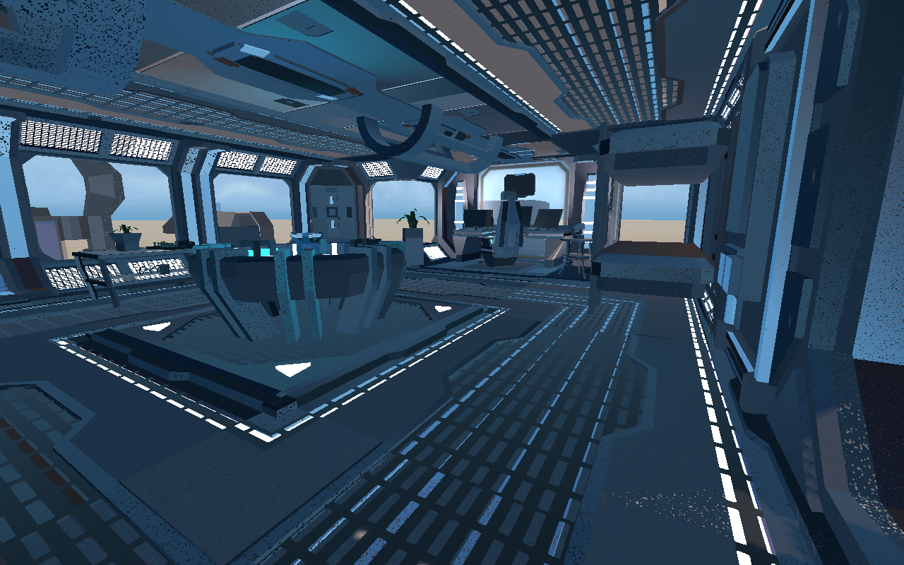
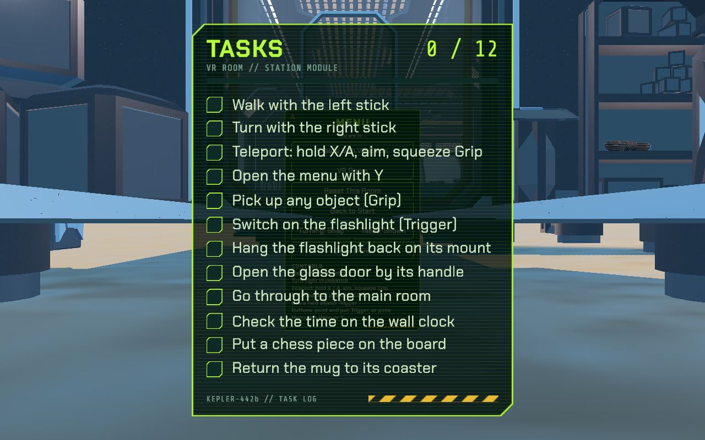

# VR Rooms — Enhanced Create with VR

A Unity VR project built on top of Unity Learn's **Create with VR** course. It contains the finished course room plus a separate, fully interactive **VR Room** built from the ALU VR Room assets, linked together by a start screen and an in-headset menu.

Built by **Duru Donald Onyebuchi** for *AR/VR Development with Unity II* (African Leadership University), continued as a personal project.

**Demo video:** [Watch the VR Rooms walkthrough on Google Drive](https://drive.google.com/file/d/16-dbBNYX2G0bcrsqNFtl7tKNwl5W6GK4/view?usp=drive_link) (recorded on a Meta Quest 2)





---

## Contents

- [Features](#features)
- [Scenes](#scenes)
- [Controls](#controls)
- [Getting started](#getting-started)
- [Project structure](#project-structure)
- [Key scripts](#key-scripts)
- [Course challenges](#course-challenges)
- [Testing](#testing)
- [Credits](#credits)

---

## Features

| Requirement | Where / how |
|---|---|
| Complete Create with VR course project | `Assets/Scenes/Donald's Room.unity` — Units 1–3: furniture, teleport + snap/smooth turning, grabbables, sockets, haptics, 3D audio, reverb, activation events (TV remote), Near-Far interactors, world-space UI, fade-in, optimisation and baked lighting |
| Separate VR Room scene from the provided assets | `Assets/VR Room/Scenes/VR Room.unity` |
| Grabbable objects | 25+ props in the VR Room (boxes, tubes, pillows, statues, origami crane, mug, flashlight, chess pieces, rope) |
| At least two filtered sockets | Flashlight mount (Flashlight layer), two chess squares (Chess Piece layer), mug coaster (Mug layer) — each socket only accepts its own interaction layer |
| Start UI + in-project UI usable with controllers | `Start Menu` scene, plus a Game Menu opened in any room with the left **Menu / Y** button; both work with the controller ray or by poking with a finger |
| Physics door opened by its handle | Glass door in the VR Room: `HingeJoint` (±100°) moved with velocity-tracked grabbing on the handle only |
| Locomotion | Walk with the left thumbstick (head-directed, with collisions), snap or smooth turning on the right thumbstick, teleport by holding **X/A** and squeezing Grip |
| Two-way scene navigation | Start Menu ⇄ Create with VR room ⇄ VR Room, from the start screen or the in-game menu, with a fade |
| Analog wall clock driven by system time | `WallClock.cs` turns the hour, minute and second hands from `DateTime.Now` every frame |
| Digital clock | Under each wall clock: `HH:mm:ss` and the full date |
| Realistic animated hands | Rigged hand models; `HandAnimator.cs` blends Open / Grip / Point / Fist poses from the analog grip and trigger values |
| Consistent behaviour | The Start Menu and VR Room share one rig prefab (`XR Setup`); the course room keeps its course rig with the same interactors, haptics, locomotion and controls. The snap / smooth turning choice is shared by every scene and remembered between sessions (Settings panel in the course room, **Turning** button on the Game Menu and start screen) |
| VR Room task checklist | A panel at the lower left of your view lists the room's 12 tasks and ticks each one off as you do it (walk, turn, teleport, menu, grab, flashlight, door, main room, clock, chess, mug). It is pinned to your view: open, it sits in the centre so it is easy to read; the **–** button on its header (or a click of the right thumbstick) minimizes it to a small progress tab in the lower-left corner. It hides while the Game Menu is open and can be hidden from the menu. Progress starts fresh on each visit |

## Scenes

Build order (File ▸ Build Profiles):

1. `Assets/_Project/Scenes/Start Menu.unity` — lobby with the start screen
2. `Assets/Scenes/Donald's Room.unity` — the Create with VR course room
3. `Assets/VR Room/Scenes/VR Room.unity` — the VR Room (storage room + main room, joined by the glass door)

Course challenge scenes live in `Assets/Challenges/` (see [Course challenges](#course-challenges)).

## Controls

| Action | Meta Quest controllers |
|---|---|
| Walk (forward is where you look) | Left thumbstick |
| Turn (snap 45° by default, or smooth) | Right thumbstick |
| Teleport | Hold **X** or **A** to show the teleport ray, aim at the floor, squeeze Grip |
| Grab (reach out, or point at it) | Grip |
| Use a held object (e.g. flashlight, TV remote) | Trigger |
| Open / close the Game Menu | Left Menu or Y (keyboard: M) |
| Reset the course room | B (keyboard: R) |
| Press UI buttons | Point the ray and pull Trigger, or poke with a finger |
| Switch snap / smooth turning | **Turning** button on the Game Menu or start screen, or the course room's Settings panel |
| Minimize / expand the VR Room checklist | **–** / **+** button on the checklist, or click the right thumbstick |
| Show / hide the VR Room checklist | **Tasks** button on the Game Menu |

In the editor without a headset, the XR Interaction Simulator shows its own key bindings on screen.

## Getting started

1. Install **Unity 6000.4.7f1** (Unity 6.4) with **Android Build Support** (for Quest).
2. Clone the repo and open the folder in Unity Hub. The first import takes a few minutes.
3. Open `Assets/_Project/Scenes/Start Menu.unity` and press Play.
   - Without a headset, the **XR Interaction Simulator** (XR Interaction Toolkit sample) lets you test with keyboard and mouse.
   - With a Quest over Link / Air Link, enable **OpenXR** for Windows/Mac in *Project Settings ▸ XR Plug-in Management*.
4. To build for Meta Quest (tested on Quest 2; Quest 3 Touch Plus controllers are enabled):
   - Turn on Developer Mode for the headset in the Meta Horizon phone app, connect it over USB-C and accept **Allow USB debugging**.
   - Switch the platform to **Android** and use *Build And Run*. The project is already set up for Quest: OpenXR with the Meta Quest feature, Vulkan, IL2CPP ARM64, min API 32, ASTC textures, single-pass instanced rendering, 4x MSAA.
   - Package `com.donaldduru.vrrooms`; on the headset it appears under *Library > Unknown Sources > VR Rooms*.
   - The XR Interaction Simulator stays in the scenes for editor testing; `Assets/Editor/StripXRSimulatorFromBuilds.cs` removes it from every build so the headset drives the camera.

### Packages

| Package | Version |
|---|---|
| Universal Render Pipeline | 17.4.0 |
| XR Interaction Toolkit (+ Starter Assets, XR Device Simulator samples) | 3.4.1 |
| XR Hands (+ Hand Visualizer sample for the hand models) | 1.5.1 |
| OpenXR Plugin | 1.16.1 |
| XR Plug-in Management | 4.5.4 |

## Project structure

```
Assets/
├── _Project/                 Everything written for this project
│   ├── Scripts/              Runtime scripts (clock, hands, navigation, menu, door)
│   ├── Prefabs/              XR Setup (shared rig), Game Menu, Animated Hand Left/Right
│   ├── Animations/Hands/     Hand pose clips + 2D blend-tree controllers
│   ├── Materials/
│   └── Scenes/Start Menu.unity
├── Scenes/Donald's Room.unity   Create with VR course room
├── VR Room/                  ALU VR Room assets + VR Room scene
├── Challenges/               Course challenges 1–3 (fixed) + challenge bonus scripts
├── _Course Library/          Unity's Create with VR course library
└── Samples/                  XR Interaction Toolkit and XR Hands samples
Docs/                         Testing checklist, walkthrough notes, screenshots
```

## Key scripts

| Script | What it does |
|---|---|
| [`WallClock.cs`](Assets/_Project/Scripts/WallClock.cs) | Reads `DateTime.Now` each frame and rotates the hands smoothly: seconds 6°/s, minutes 6°/min (+ seconds/60), hours 30°/h (+ minutes/60). Also writes the digital time and date. |
| [`HandAnimator.cs`](Assets/_Project/Scripts/HandAnimator.cs) | Reads the analog grip and trigger actions, smooths them, and feeds `Grip` / `Trigger` floats into a 2D blend tree (Open, Grip, Point, Fist). |
| [`SceneNavigator.cs`](Assets/_Project/Scripts/SceneNavigator.cs) | Loads Start Menu / course room / VR Room with a fade. Each scene has its own rig, so interactions are fresh after every transition. |
| [`InGameMenu.cs`](Assets/_Project/Scripts/InGameMenu.cs) | Opens the Game Menu in front of the player from the left Menu/Y button (or M), with room navigation, reset and instructions. |
| [`VRRoomChecklist.cs`](Assets/_Project/Scripts/VRRoomChecklist.cs) | The VR Room task list: listens to locomotion providers, grab / activate / socket events, the door hinge angle, the player's position and gaze, and ticks rows off with a short controller buzz. Pinned to the view (child of the camera): centred while open, a header tab in the lower-left corner when minimized. |
| [`TurnSettings.cs`](Assets/_Project/Scripts/TurnSettings.cs) · [`MenuOptions.cs`](Assets/_Project/Scripts/MenuOptions.cs) · [`TurnSettingsToggles.cs`](Assets/_Project/Scripts/TurnSettingsToggles.cs) | Snap / smooth turning shared by all scenes (saved in `PlayerPrefs`) and applied whenever a scene loads; the menu buttons and course-room toggles read and write it. |
| [`FlashlightSwitch.cs`](Assets/_Project/Scripts/FlashlightSwitch.cs) | Pull the trigger while holding the VR Room flashlight to switch its light on or off. |
| [`IgnoreCollisionsWith.cs`](Assets/_Project/Scripts/IgnoreCollisionsWith.cs) | Stops the hinged door colliding with its frame and the floor tiles around the doorway so it swings freely. |
| [`PaintTurntable.cs`](Assets/Challenges/02_3DPainting/Scripts/PaintTurntable.cs) | Challenge 2 bonus: collects finished paint strokes onto a turntable, rotates it from a slider and prints a miniature copy. |
| [`TrainingProgress.cs`](Assets/Challenges/03_Training/Scripts/TrainingProgress.cs) · [`MagnetSpeedControl.cs`](Assets/Challenges/03_Training/Scripts/MagnetSpeedControl.cs) | Challenge 3 bonus: boxes-on-platform counter, timer and magnet speed buttons. |

## Course challenges

| Challenge | Fixed | Bonus |
|---|---|---|
| 1 — Architecture | Attach points, socket radius, interaction layers, table scale, anchor facing, curved fading ray, ambient audio | — |
| 2 — 3D Painting | World-space pedestal UI, correct hand tracking for ray and palette, brush paints while trigger is held, medium brush button, 3D brush audio | UI sounds, show/hide pedestal, **rotate slider**, **Print** button |
| 3 — Training Simulation | Fade covers the view, labels toggle, floor lightmap scale, static box pile, light probes for the console | Magnet colour indicator, console locked until instructions finish, **magnet speed buttons**, **progress panel** |

## Testing

See [Docs/TESTING.md](Docs/TESTING.md) for what has been tested in the editor and on a Meta Quest 2, and what still needs a headset run. Build and install steps are in [Getting started](#getting-started).

## Credits

- Course content, models and course library: [Unity Learn — Create with VR](https://learn.unity.com/course/create-with-vr)
- VR Room assets: ALU Software Engineering (AR/VR) resources
- Hand models: XR Hands package, Hand Visualizer sample
